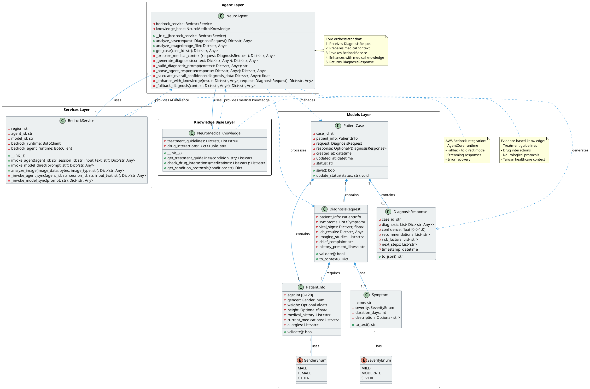
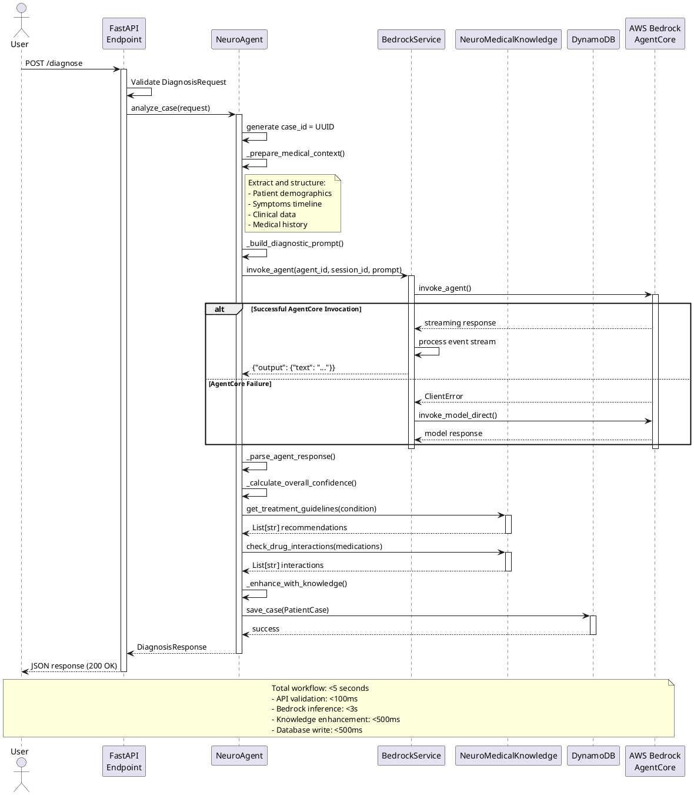
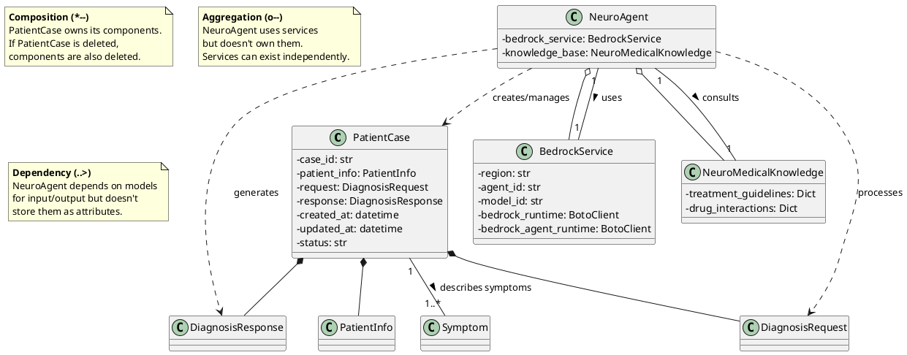
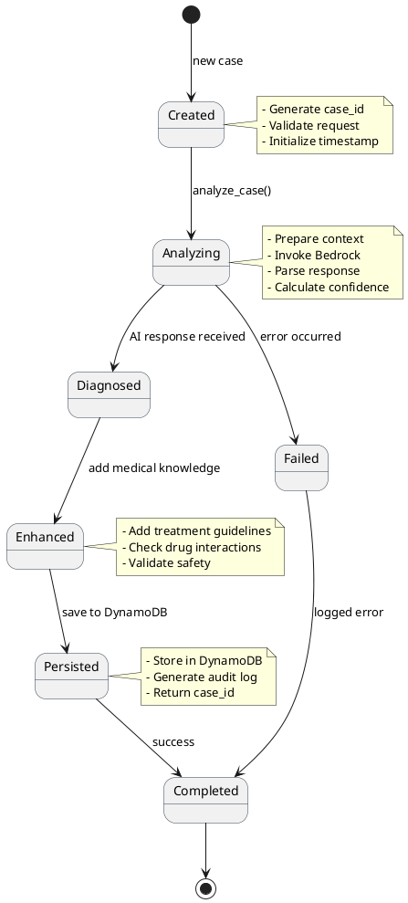
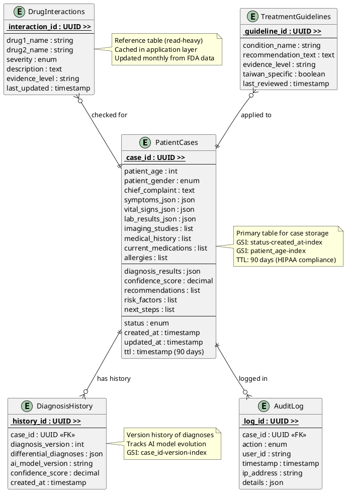
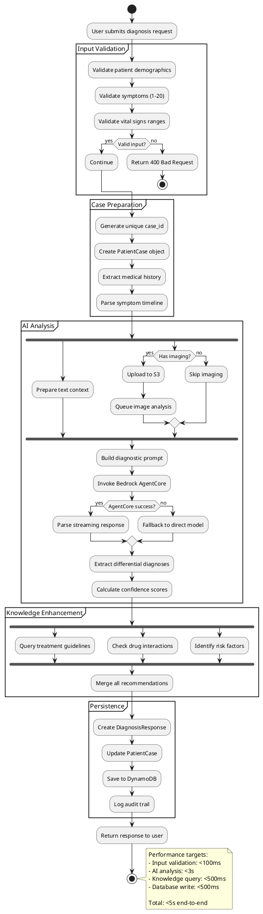
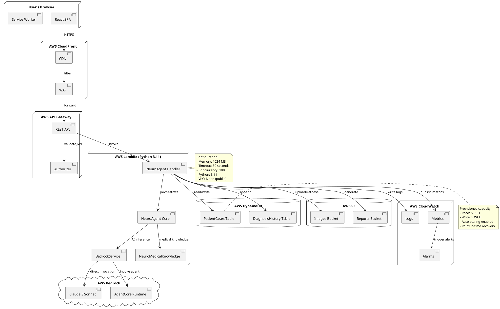

# NeuroAgent Architecture - UML Class Diagrams

## Overview
This document provides comprehensive PlantUML diagrams for the NeuroAgent system architecture, following the structure defined in CLAUDE.md.

---

## 1. Core System Class Diagram



---

## 2. Sequence Diagram: Diagnosis Workflow



---

## 3. Component Diagram: AWS Architecture

```plantuml
@startuml AWS_Architecture

!include <awslib/AWSCommon>
!include <awslib/Compute/Lambda>
!include <awslib/ApplicationIntegration/APIGateway>
!include <awslib/Database/DynamoDB>
!include <awslib/Storage/S3Bucket>
!include <awslib/MachineLearning/SageMaker>
!include <awslib/ManagementGovernance/CloudWatch>

skinparam backgroundColor #FFFFFF

cloud "Frontend" {
    component [React 18 SPA] as Frontend
    component [Material-UI] as MUI
}

package "AWS Infrastructure" {
    APIGateway(gateway, "API Gateway", "REST API")
    Lambda(lambda, "Lambda Functions", "Python 3.11")
    DynamoDB(dynamodb, "DynamoDB", "Cases Storage")
    S3Bucket(s3, "S3 Bucket", "Medical Images")
    SageMaker(bedrock, "Amazon Bedrock", "Claude 3 Sonnet")
    CloudWatch(cloudwatch, "CloudWatch", "Logs & Metrics")

    component "NeuroAgent\nCore" as Agent
    component "BedrockService" as Bedrock
    component "KnowledgeBase" as KB
}

Frontend --> gateway : HTTPS requests
MUI --> Frontend : UI components

gateway --> lambda : invoke
lambda --> Agent : orchestrate
Agent --> Bedrock : AI inference
Agent --> KB : medical knowledge
Bedrock --> bedrock : API calls

lambda --> dynamodb : read/write cases
lambda --> s3 : store/retrieve images
lambda --> cloudwatch : logs

note right of gateway
  Endpoints:
  - POST /diagnose
  - GET /cases/{id}
  - POST /upload-image
  - GET /health
end note

note right of dynamodb
  Tables:
  - PatientCases
  - DiagnosisHistory
  - AuditLog
end note

note right of s3
  Buckets:
  - medical-images/
  - reports/
  Lifecycle: 90 days
end note

@enduml
```

---

## 4. Detailed Class Relationships



---

## 5. State Diagram: PatientCase Lifecycle



---

## 6. ER Diagram: Database Schema



---

## 7. Activity Diagram: Multi-Modal Diagnosis Flow



---

## 8. Deployment Diagram



---

## Summary of Key Relationships

### 1. **PatientCase ↔ Models** (Composition)
- PatientCase **owns** PatientInfo, DiagnosisRequest, DiagnosisResponse
- Lifecycle: Created together, destroyed together
- File: `backend/models/patient.py:49-56`

### 2. **NeuroAgent ↔ BedrockService** (Aggregation)
- NeuroAgent **uses** BedrockService for AI inference
- BedrockService can exist independently
- Relationship: 1-to-1
- File: `backend/agents/neuro_agent.py:11-13`

### 3. **NeuroAgent ↔ NeuroMedicalKnowledge** (Aggregation)
- NeuroAgent **consults** knowledge base for medical guidelines
- Knowledge base is shared across multiple agents
- Relationship: 1-to-1
- File: `backend/agents/neuro_agent.py:11-13`

### 4. **BedrockService ↔ AWS Bedrock** (Dependency)
- BedrockService **depends on** AWS Bedrock API
- Two modes: AgentCore or direct model invocation
- Fallback mechanism for resilience
- File: `backend/services/bedrock_service.py:18-35`

### 5. **NeuroAgent → PatientCase** (Dependency)
- NeuroAgent **creates and manages** PatientCase instances
- Processes DiagnosisRequest → generates DiagnosisResponse
- Stateless processing (no persistent storage in agent)
- File: `backend/agents/neuro_agent.py:15-36`

---

## Architecture Principles

### 1. **Separation of Concerns**
- Models: Data structures only
- Services: External integrations (AWS, APIs)
- Agents: Business logic orchestration
- Utils: Reusable knowledge bases

### 2. **Dependency Injection**
- NeuroAgent receives BedrockService via constructor
- Enables testing with mock services
- Follows SOLID principles

### 3. **Fail-Safe Design**
- Bedrock AgentCore → fallback to direct model
- Direct model → fallback to rule-based diagnosis
- Multiple layers of error handling

### 4. **Stateless Processing**
- Lambda functions are stateless
- All state stored in DynamoDB
- Enables horizontal scaling

### 5. **Multi-Modal Support**
- Text: Symptoms, history, complaints
- Structured: Vital signs, lab results
- Images: CT/MRI scans (future: AI analysis)

---

## Code References

| Component | File Path | Lines |
|-----------|-----------|-------|
| PatientCase | `backend/models/patient.py` | 49-56 |
| NeuroAgent | `backend/agents/neuro_agent.py` | 10-231 |
| BedrockService | `backend/services/bedrock_service.py` | 8-135 |
| NeuroMedicalKnowledge | `backend/utils/medical_knowledge.py` | 3-62 |
| DiagnosisRequest | `backend/models/patient.py` | 31-38 |
| DiagnosisResponse | `backend/models/patient.py` | 40-47 |

---

**Document Version**: 1.0
**Last Updated**: October 12, 2025
**Author**: Claude Code with NeuroAgent Team
**Purpose**: AWS AI Agent Global Hackathon - Architecture Documentation
