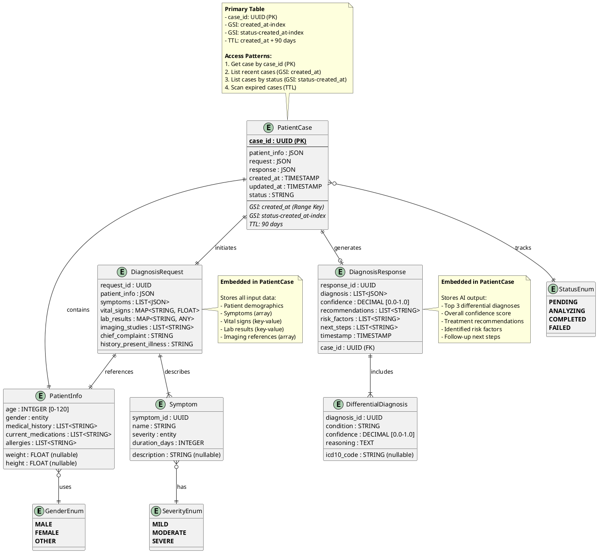

# NeuroAgent Database Schema - ER Diagram & Table Definitions

## Overview
This document provides comprehensive database schema based on `backend/models/patient.py` including:
- Entity-Relationship (ER) diagrams
- DynamoDB table definitions with GSI
- Alternative PostgreSQL schema
- Data migration scripts

---

## 1. Entity-Relationship Diagram



---

## 2. DynamoDB Table Definition

### 2.1 Using AWS CDK (Python)

```python
from aws_cdk import (
    Stack,
    aws_dynamodb as dynamodb,
    RemovalPolicy,
    Duration
)
from constructs import Construct

class NeuroAgentDatabaseStack(Stack):
    def __init__(self, scope: Construct, construct_id: str, **kwargs) -> None:
        super().__init__(scope, construct_id, **kwargs)

        # PatientCases Table
        self.patient_cases_table = dynamodb.Table(
            self, "PatientCasesTable",
            table_name="NeuroAgent-PatientCases",

            # Primary Key
            partition_key=dynamodb.Attribute(
                name="case_id",
                type=dynamodb.AttributeType.STRING
            ),

            # Billing Mode
            billing_mode=dynamodb.BillingMode.PAY_PER_REQUEST,  # On-demand

            # Encryption
            encryption=dynamodb.TableEncryption.AWS_MANAGED,

            # Point-in-time Recovery
            point_in_time_recovery=True,

            # TTL (Time to Live) - HIPAA compliance
            time_to_live_attribute="ttl",

            # Removal Policy
            removal_policy=RemovalPolicy.RETAIN,  # Don't delete on stack destroy

            # Stream for change data capture
            stream=dynamodb.StreamViewType.NEW_AND_OLD_IMAGES
        )

        # Global Secondary Index: created_at-index
        self.patient_cases_table.add_global_secondary_index(
            index_name="created_at-index",
            partition_key=dynamodb.Attribute(
                name="entity_type",  # Fixed value: "CASE"
                type=dynamodb.AttributeType.STRING
            ),
            sort_key=dynamodb.Attribute(
                name="created_at",
                type=dynamodb.AttributeType.STRING  # ISO 8601 format
            ),
            projection_type=dynamodb.ProjectionType.ALL
        )

        # Global Secondary Index: status-created_at-index
        self.patient_cases_table.add_global_secondary_index(
            index_name="status-created_at-index",
            partition_key=dynamodb.Attribute(
                name="status",
                type=dynamodb.AttributeType.STRING
            ),
            sort_key=dynamodb.Attribute(
                name="created_at",
                type=dynamodb.AttributeType.STRING
            ),
            projection_type=dynamodb.ProjectionType.KEYS_ONLY
        )

        # Global Secondary Index: patient_age-index (for analytics)
        self.patient_cases_table.add_global_secondary_index(
            index_name="patient_age-index",
            partition_key=dynamodb.Attribute(
                name="patient_age_group",  # "0-18", "19-40", "41-60", "61+"
                type=dynamodb.AttributeType.STRING
            ),
            sort_key=dynamodb.Attribute(
                name="created_at",
                type=dynamodb.AttributeType.STRING
            ),
            projection_type=dynamodb.ProjectionType.INCLUDE,
            non_key_attributes=[
                "case_id", "chief_complaint", "confidence_score"
            ]
        )
```

### 2.2 Using Boto3 (Python)

```python
import boto3
from botocore.exceptions import ClientError

dynamodb = boto3.client('dynamodb', region_name='us-east-1')

def create_patient_cases_table():
    """Create PatientCases DynamoDB table with GSIs"""

    try:
        response = dynamodb.create_table(
            TableName='NeuroAgent-PatientCases',

            # Key Schema
            KeySchema=[
                {
                    'AttributeName': 'case_id',
                    'KeyType': 'HASH'  # Partition key
                }
            ],

            # Attribute Definitions
            AttributeDefinitions=[
                {'AttributeName': 'case_id', 'AttributeType': 'S'},
                {'AttributeName': 'created_at', 'AttributeType': 'S'},
                {'AttributeName': 'status', 'AttributeType': 'S'},
                {'AttributeName': 'entity_type', 'AttributeType': 'S'},
                {'AttributeName': 'patient_age_group', 'AttributeType': 'S'}
            ],

            # Global Secondary Indexes
            GlobalSecondaryIndexes=[
                {
                    'IndexName': 'created_at-index',
                    'KeySchema': [
                        {'AttributeName': 'entity_type', 'KeyType': 'HASH'},
                        {'AttributeName': 'created_at', 'KeyType': 'RANGE'}
                    ],
                    'Projection': {'ProjectionType': 'ALL'},
                    'ProvisionedThroughput': {
                        'ReadCapacityUnits': 5,
                        'WriteCapacityUnits': 5
                    }
                },
                {
                    'IndexName': 'status-created_at-index',
                    'KeySchema': [
                        {'AttributeName': 'status', 'KeyType': 'HASH'},
                        {'AttributeName': 'created_at', 'KeyType': 'RANGE'}
                    ],
                    'Projection': {'ProjectionType': 'KEYS_ONLY'},
                    'ProvisionedThroughput': {
                        'ReadCapacityUnits': 5,
                        'WriteCapacityUnits': 5
                    }
                },
                {
                    'IndexName': 'patient_age-index',
                    'KeySchema': [
                        {'AttributeName': 'patient_age_group', 'KeyType': 'HASH'},
                        {'AttributeName': 'created_at', 'KeyType': 'RANGE'}
                    ],
                    'Projection': {
                        'ProjectionType': 'INCLUDE',
                        'NonKeyAttributes': ['case_id', 'chief_complaint', 'confidence_score']
                    },
                    'ProvisionedThroughput': {
                        'ReadCapacityUnits': 3,
                        'WriteCapacityUnits': 3
                    }
                }
            ],

            # Billing Mode
            BillingMode='PAY_PER_REQUEST',  # On-demand pricing

            # Stream Specification
            StreamSpecification={
                'StreamEnabled': True,
                'StreamViewType': 'NEW_AND_OLD_IMAGES'
            },

            # SSE Specification
            SSESpecification={
                'Enabled': True,
                'SSEType': 'AES256'  # AWS managed encryption
            },

            # Tags
            Tags=[
                {'Key': 'Project', 'Value': 'NeuroAgent'},
                {'Key': 'Environment', 'Value': 'Production'},
                {'Key': 'Compliance', 'Value': 'HIPAA'}
            ]
        )

        print(f"Table creation initiated: {response['TableDescription']['TableName']}")
        print(f"Table ARN: {response['TableDescription']['TableArn']}")

        # Wait for table to be active
        waiter = dynamodb.get_waiter('table_exists')
        waiter.wait(TableName='NeuroAgent-PatientCases')

        # Enable Point-in-Time Recovery
        dynamodb.update_continuous_backups(
            TableName='NeuroAgent-PatientCases',
            PointInTimeRecoverySpecification={
                'PointInTimeRecoveryEnabled': True
            }
        )
        print("Point-in-time recovery enabled")

        # Enable TTL
        dynamodb.update_time_to_live(
            TableName='NeuroAgent-PatientCases',
            TimeToLiveSpecification={
                'Enabled': True,
                'AttributeName': 'ttl'
            }
        )
        print("TTL enabled on 'ttl' attribute")

        return response

    except ClientError as e:
        print(f"Error creating table: {e.response['Error']['Message']}")
        raise
```

---

## 3. DynamoDB Item Structure

### 3.1 Sample PatientCase Item

```json
{
  "case_id": {
    "S": "a1b2c3d4-e5f6-7890-abcd-ef1234567890"
  },
  "entity_type": {
    "S": "CASE"
  },
  "status": {
    "S": "completed"
  },
  "created_at": {
    "S": "2025-10-12T14:30:00.000Z"
  },
  "updated_at": {
    "S": "2025-10-12T14:30:05.123Z"
  },
  "ttl": {
    "N": "1733932800"
  },
  "patient_info": {
    "M": {
      "age": {
        "N": "45"
      },
      "gender": {
        "S": "male"
      },
      "weight": {
        "N": "75.5"
      },
      "height": {
        "N": "175.0"
      },
      "medical_history": {
        "L": [
          {"S": "Hypertension"},
          {"S": "Type 2 Diabetes"}
        ]
      },
      "current_medications": {
        "L": [
          {"S": "Lisinopril 10mg"},
          {"S": "Metformin 500mg"}
        ]
      },
      "allergies": {
        "L": [
          {"S": "Penicillin"}
        ]
      }
    }
  },
  "patient_age_group": {
    "S": "41-60"
  },
  "request": {
    "M": {
      "symptoms": {
        "L": [
          {
            "M": {
              "name": {"S": "Headache"},
              "severity": {"S": "severe"},
              "duration_days": {"N": "3"},
              "description": {"S": "Throbbing pain in right temple"}
            }
          },
          {
            "M": {
              "name": {"S": "Nausea"},
              "severity": {"S": "moderate"},
              "duration_days": {"N": "2"},
              "description": {"S": "Occasional nausea with headache"}
            }
          }
        ]
      },
      "vital_signs": {
        "M": {
          "blood_pressure_systolic": {"N": "145"},
          "blood_pressure_diastolic": {"N": "90"},
          "heart_rate": {"N": "78"},
          "temperature": {"N": "37.2"},
          "respiratory_rate": {"N": "16"}
        }
      },
      "lab_results": {
        "M": {
          "glucose": {"N": "110"},
          "hemoglobin": {"N": "14.2"}
        }
      },
      "imaging_studies": {
        "L": [
          {"S": "CT Brain - negative for acute findings"}
        ]
      },
      "chief_complaint": {
        "S": "Severe headache for 3 days"
      },
      "history_present_illness": {
        "S": "Patient presents with 3-day history of severe right-sided headache..."
      }
    }
  },
  "response": {
    "M": {
      "diagnosis": {
        "L": [
          {
            "M": {
              "condition": {"S": "Migraine with aura"},
              "confidence": {"N": "0.85"},
              "reasoning": {"S": "Unilateral severe headache with associated nausea..."},
              "icd10_code": {"S": "G43.109"}
            }
          },
          {
            "M": {
              "condition": {"S": "Tension-type headache"},
              "confidence": {"N": "0.65"},
              "reasoning": {"S": "Duration and pattern consistent with TTH..."},
              "icd10_code": {"S": "G44.209"}
            }
          },
          {
            "M": {
              "condition": {"S": "Cluster headache"},
              "confidence": {"N": "0.45"},
              "reasoning": {"S": "Unilateral presentation, though duration atypical..."},
              "icd10_code": {"S": "G44.009"}
            }
          }
        ]
      },
      "confidence": {
        "N": "0.71"
      },
      "recommendations": {
        "L": [
          {"S": "Consider triptans for acute treatment"},
          {"S": "Evaluate need for prophylactic therapy"},
          {"S": "Assess trigger factors (stress, sleep, diet)"},
          {"S": "Monitor blood pressure due to current medications"}
        ]
      },
      "risk_factors": {
        "L": [
          {"S": "Drug interaction: Lisinopril + Metformin - monitor renal function"},
          {"S": "Age-related cardiovascular risk"},
          {"S": "Hypertension may exacerbate headache"}
        ]
      },
      "next_steps": {
        "L": [
          {"S": "Neurologist consultation if symptoms persist"},
          {"S": "Consider MRI if symptoms worsen"},
          {"S": "Follow-up in 2 weeks"}
        ]
      },
      "timestamp": {
        "S": "2025-10-12T14:30:05.123Z"
      }
    }
  },
  "chief_complaint": {
    "S": "Severe headache for 3 days"
  },
  "confidence_score": {
    "N": "0.71"
  },
  "ai_model_version": {
    "S": "anthropic.claude-3-sonnet-20240229-v1:0"
  },
  "processing_time_ms": {
    "N": "3456"
  }
}
```

---

## 4. Access Patterns & Queries

### 4.1 Get Case by ID (Primary Key)

```python
import boto3
from boto3.dynamodb.conditions import Key

dynamodb = boto3.resource('dynamodb')
table = dynamodb.Table('NeuroAgent-PatientCases')

def get_case_by_id(case_id: str):
    """Get a single case by case_id"""
    response = table.get_item(
        Key={'case_id': case_id}
    )
    return response.get('Item')
```

### 4.2 List Recent Cases (GSI: created_at-index)

```python
def list_recent_cases(limit: int = 20):
    """List most recent cases using created_at GSI"""
    response = table.query(
        IndexName='created_at-index',
        KeyConditionExpression=Key('entity_type').eq('CASE'),
        ScanIndexForward=False,  # Descending order (newest first)
        Limit=limit
    )
    return response['Items']
```

### 4.3 List Cases by Status (GSI: status-created_at-index)

```python
def list_cases_by_status(status: str, limit: int = 20):
    """List cases filtered by status"""
    response = table.query(
        IndexName='status-created_at-index',
        KeyConditionExpression=Key('status').eq(status),
        ScanIndexForward=False,
        Limit=limit
    )
    return response['Items']
```

### 4.4 Query Cases by Age Group (GSI: patient_age-index)

```python
def query_cases_by_age_group(age_group: str, limit: int = 50):
    """Query cases by patient age group for analytics"""
    response = table.query(
        IndexName='patient_age-index',
        KeyConditionExpression=Key('patient_age_group').eq(age_group),
        ScanIndexForward=False,
        Limit=limit
    )
    return response['Items']
```

### 4.5 Scan Expired Cases (TTL Check)

```python
import time

def get_expired_cases():
    """Scan for cases that should be deleted (TTL expired)"""
    current_timestamp = int(time.time())

    response = table.scan(
        FilterExpression='ttl < :current_time',
        ExpressionAttributeValues={
            ':current_time': current_timestamp
        }
    )
    return response['Items']
```

---

## 5. Alternative: PostgreSQL Schema

For traditional relational database requirements (e.g., complex analytics, OLAP workloads):

```sql
-- ============================================================
-- NeuroAgent PostgreSQL Database Schema
-- ============================================================

-- Enable UUID extension
CREATE EXTENSION IF NOT EXISTS "uuid-ossp";

-- Enable JSONB functions
CREATE EXTENSION IF NOT EXISTS "btree_gin";

-- ============================================================
-- ENUMS
-- ============================================================

CREATE TYPE gender_enum AS ENUM ('male', 'female', 'other');
CREATE TYPE severity_enum AS ENUM ('mild', 'moderate', 'severe');
CREATE TYPE case_status_enum AS ENUM ('pending', 'analyzing', 'completed', 'failed');

-- ============================================================
-- TABLES
-- ============================================================

-- PatientCases: Main table
CREATE TABLE patient_cases (
    case_id UUID PRIMARY KEY DEFAULT uuid_generate_v4(),

    -- Status tracking
    status case_status_enum NOT NULL DEFAULT 'pending',

    -- Timestamps
    created_at TIMESTAMP WITH TIME ZONE NOT NULL DEFAULT CURRENT_TIMESTAMP,
    updated_at TIMESTAMP WITH TIME ZONE NOT NULL DEFAULT CURRENT_TIMESTAMP,

    -- TTL for HIPAA compliance (90 days)
    expires_at TIMESTAMP WITH TIME ZONE NOT NULL DEFAULT (CURRENT_TIMESTAMP + INTERVAL '90 days'),

    -- Patient demographics (denormalized for performance)
    patient_age INTEGER CHECK (patient_age >= 0 AND patient_age <= 120),
    patient_gender gender_enum,
    patient_age_group VARCHAR(10) GENERATED ALWAYS AS (
        CASE
            WHEN patient_age < 19 THEN '0-18'
            WHEN patient_age < 41 THEN '19-40'
            WHEN patient_age < 61 THEN '41-60'
            ELSE '61+'
        END
    ) STORED,

    -- Request data (JSON for flexibility)
    patient_info JSONB NOT NULL,
    symptoms JSONB NOT NULL,
    vital_signs JSONB,
    lab_results JSONB,
    imaging_studies TEXT[],
    chief_complaint TEXT NOT NULL,
    history_present_illness TEXT,

    -- Response data (JSON for flexibility)
    diagnosis_results JSONB,
    confidence_score DECIMAL(3,2) CHECK (confidence_score >= 0 AND confidence_score <= 1),
    recommendations TEXT[],
    risk_factors TEXT[],
    next_steps TEXT[],

    -- Metadata
    ai_model_version VARCHAR(100),
    processing_time_ms INTEGER,

    -- Audit
    created_by VARCHAR(100),
    updated_by VARCHAR(100)
);

-- Symptoms: Normalized symptom tracking
CREATE TABLE symptoms (
    symptom_id UUID PRIMARY KEY DEFAULT uuid_generate_v4(),
    case_id UUID NOT NULL REFERENCES patient_cases(case_id) ON DELETE CASCADE,

    name VARCHAR(255) NOT NULL,
    severity severity_enum NOT NULL,
    duration_days INTEGER NOT NULL CHECK (duration_days >= 0),
    description TEXT,

    created_at TIMESTAMP WITH TIME ZONE NOT NULL DEFAULT CURRENT_TIMESTAMP
);

-- DifferentialDiagnoses: Normalized diagnosis tracking
CREATE TABLE differential_diagnoses (
    diagnosis_id UUID PRIMARY KEY DEFAULT uuid_generate_v4(),
    case_id UUID NOT NULL REFERENCES patient_cases(case_id) ON DELETE CASCADE,

    condition_name VARCHAR(255) NOT NULL,
    confidence DECIMAL(3,2) NOT NULL CHECK (confidence >= 0 AND confidence <= 1),
    reasoning TEXT,
    icd10_code VARCHAR(10),
    rank INTEGER NOT NULL,

    created_at TIMESTAMP WITH TIME ZONE NOT NULL DEFAULT CURRENT_TIMESTAMP
);

-- DiagnosisHistory: Audit trail for diagnosis changes
CREATE TABLE diagnosis_history (
    history_id UUID PRIMARY KEY DEFAULT uuid_generate_v4(),
    case_id UUID NOT NULL REFERENCES patient_cases(case_id) ON DELETE CASCADE,

    diagnosis_version INTEGER NOT NULL,
    diagnosis_results JSONB NOT NULL,
    confidence_score DECIMAL(3,2),
    ai_model_version VARCHAR(100),

    created_at TIMESTAMP WITH TIME ZONE NOT NULL DEFAULT CURRENT_TIMESTAMP,
    created_by VARCHAR(100)
);

-- AuditLog: Comprehensive audit trail
CREATE TABLE audit_log (
    log_id UUID PRIMARY KEY DEFAULT uuid_generate_v4(),
    case_id UUID REFERENCES patient_cases(case_id) ON DELETE SET NULL,

    action VARCHAR(50) NOT NULL,
    user_id VARCHAR(100) NOT NULL,
    ip_address INET,
    user_agent TEXT,
    details JSONB,

    created_at TIMESTAMP WITH TIME ZONE NOT NULL DEFAULT CURRENT_TIMESTAMP
);

-- ============================================================
-- INDEXES
-- ============================================================

-- Primary access pattern: Get case by ID (already indexed by PK)

-- GSI equivalent: List recent cases
CREATE INDEX idx_patient_cases_created_at
    ON patient_cases(created_at DESC);

-- GSI equivalent: List cases by status
CREATE INDEX idx_patient_cases_status_created_at
    ON patient_cases(status, created_at DESC);

-- Analytics: Age group queries
CREATE INDEX idx_patient_cases_age_group
    ON patient_cases(patient_age_group, created_at DESC);

-- Full-text search on chief complaint
CREATE INDEX idx_patient_cases_chief_complaint_fts
    ON patient_cases USING gin(to_tsvector('english', chief_complaint));

-- JSONB indexing for fast queries
CREATE INDEX idx_patient_cases_patient_info_gin
    ON patient_cases USING gin(patient_info);

CREATE INDEX idx_patient_cases_diagnosis_results_gin
    ON patient_cases USING gin(diagnosis_results);

-- Foreign key indexes
CREATE INDEX idx_symptoms_case_id
    ON symptoms(case_id);

CREATE INDEX idx_differential_diagnoses_case_id
    ON differential_diagnoses(case_id, rank);

CREATE INDEX idx_diagnosis_history_case_id
    ON diagnosis_history(case_id, diagnosis_version DESC);

CREATE INDEX idx_audit_log_case_id
    ON audit_log(case_id, created_at DESC);

-- TTL cleanup index
CREATE INDEX idx_patient_cases_expires_at
    ON patient_cases(expires_at)
    WHERE expires_at < CURRENT_TIMESTAMP;

-- ============================================================
-- TRIGGERS
-- ============================================================

-- Auto-update updated_at timestamp
CREATE OR REPLACE FUNCTION update_updated_at_column()
RETURNS TRIGGER AS $$
BEGIN
    NEW.updated_at = CURRENT_TIMESTAMP;
    RETURN NEW;
END;
$$ LANGUAGE plpgsql;

CREATE TRIGGER trg_patient_cases_updated_at
    BEFORE UPDATE ON patient_cases
    FOR EACH ROW
    EXECUTE FUNCTION update_updated_at_column();

-- Auto-create audit log entry
CREATE OR REPLACE FUNCTION create_audit_log_entry()
RETURNS TRIGGER AS $$
BEGIN
    IF (TG_OP = 'INSERT') THEN
        INSERT INTO audit_log (case_id, action, user_id, details)
        VALUES (NEW.case_id, 'CREATE', NEW.created_by, row_to_json(NEW));
    ELSIF (TG_OP = 'UPDATE') THEN
        INSERT INTO audit_log (case_id, action, user_id, details)
        VALUES (NEW.case_id, 'UPDATE', NEW.updated_by,
                jsonb_build_object('old', row_to_json(OLD), 'new', row_to_json(NEW)));
    ELSIF (TG_OP = 'DELETE') THEN
        INSERT INTO audit_log (case_id, action, user_id, details)
        VALUES (OLD.case_id, 'DELETE', CURRENT_USER, row_to_json(OLD));
    END IF;
    RETURN NULL;
END;
$$ LANGUAGE plpgsql;

CREATE TRIGGER trg_patient_cases_audit
    AFTER INSERT OR UPDATE OR DELETE ON patient_cases
    FOR EACH ROW
    EXECUTE FUNCTION create_audit_log_entry();

-- ============================================================
-- VIEWS
-- ============================================================

-- View: Recent cases with summary
CREATE VIEW vw_recent_cases AS
SELECT
    case_id,
    status,
    patient_age,
    patient_gender,
    chief_complaint,
    confidence_score,
    array_length(recommendations, 1) as recommendation_count,
    created_at,
    updated_at
FROM patient_cases
WHERE created_at >= CURRENT_TIMESTAMP - INTERVAL '30 days'
ORDER BY created_at DESC;

-- View: Case statistics by age group
CREATE VIEW vw_cases_by_age_group AS
SELECT
    patient_age_group,
    COUNT(*) as total_cases,
    AVG(confidence_score) as avg_confidence,
    AVG(processing_time_ms) as avg_processing_time_ms,
    COUNT(*) FILTER (WHERE status = 'completed') as completed_cases,
    COUNT(*) FILTER (WHERE status = 'failed') as failed_cases
FROM patient_cases
GROUP BY patient_age_group;

-- ============================================================
-- FUNCTIONS
-- ============================================================

-- Function: Search cases by symptoms
CREATE OR REPLACE FUNCTION search_cases_by_symptoms(symptom_keywords TEXT[])
RETURNS TABLE (
    case_id UUID,
    chief_complaint TEXT,
    confidence_score DECIMAL,
    created_at TIMESTAMP WITH TIME ZONE
) AS $$
BEGIN
    RETURN QUERY
    SELECT
        pc.case_id,
        pc.chief_complaint,
        pc.confidence_score,
        pc.created_at
    FROM patient_cases pc
    WHERE EXISTS (
        SELECT 1
        FROM jsonb_array_elements(pc.symptoms) as symptom
        WHERE symptom->>'name' = ANY(symptom_keywords)
    )
    ORDER BY pc.created_at DESC;
END;
$$ LANGUAGE plpgsql;

-- Function: Get top diagnoses
CREATE OR REPLACE FUNCTION get_top_diagnoses(limit_count INTEGER DEFAULT 10)
RETURNS TABLE (
    condition_name VARCHAR,
    occurrence_count BIGINT,
    avg_confidence DECIMAL
) AS $$
BEGIN
    RETURN QUERY
    SELECT
        dd.condition_name,
        COUNT(*) as occurrence_count,
        AVG(dd.confidence) as avg_confidence
    FROM differential_diagnoses dd
    WHERE dd.rank = 1  -- Only top diagnosis per case
    GROUP BY dd.condition_name
    ORDER BY COUNT(*) DESC
    LIMIT limit_count;
END;
$$ LANGUAGE plpgsql;

-- ============================================================
-- SCHEDULED CLEANUP (using pg_cron extension)
-- ============================================================

-- Delete expired cases (requires pg_cron extension)
-- CREATE EXTENSION IF NOT EXISTS pg_cron;

-- Schedule daily cleanup at 2 AM
-- SELECT cron.schedule('cleanup-expired-cases', '0 2 * * *', $$
--     DELETE FROM patient_cases WHERE expires_at < CURRENT_TIMESTAMP
-- $$);

-- ============================================================
-- SAMPLE QUERIES
-- ============================================================

-- Query 1: Get case by ID
-- SELECT * FROM patient_cases WHERE case_id = 'a1b2c3d4-...';

-- Query 2: List recent cases
-- SELECT * FROM vw_recent_cases LIMIT 20;

-- Query 3: List cases by status
-- SELECT case_id, chief_complaint, created_at
-- FROM patient_cases
-- WHERE status = 'completed'
-- ORDER BY created_at DESC
-- LIMIT 20;

-- Query 4: Search by symptoms
-- SELECT * FROM search_cases_by_symptoms(ARRAY['headache', 'nausea']);

-- Query 5: Get top diagnoses
-- SELECT * FROM get_top_diagnoses(10);

-- Query 6: Cases requiring attention (low confidence)
-- SELECT case_id, chief_complaint, confidence_score
-- FROM patient_cases
-- WHERE confidence_score < 0.6 AND status = 'completed'
-- ORDER BY confidence_score ASC;

-- ============================================================
-- GRANTS (adjust as needed)
-- ============================================================

-- Create read-only role for analytics
-- CREATE ROLE neuroagent_readonly;
-- GRANT SELECT ON ALL TABLES IN SCHEMA public TO neuroagent_readonly;

-- Create application role
-- CREATE ROLE neuroagent_app;
-- GRANT SELECT, INSERT, UPDATE ON ALL TABLES IN SCHEMA public TO neuroagent_app;
-- GRANT USAGE, SELECT ON ALL SEQUENCES IN SCHEMA public TO neuroagent_app;
```

---

## 6. Data Migration Scripts

### 6.1 DynamoDB to PostgreSQL

```python
import boto3
import psycopg2
import json
from decimal import Decimal

class DecimalEncoder(json.JSONEncoder):
    def default(self, obj):
        if isinstance(obj, Decimal):
            return float(obj)
        return super(DecimalEncoder, self).default(obj)

def migrate_dynamodb_to_postgres():
    """Migrate data from DynamoDB to PostgreSQL"""

    # Connect to DynamoDB
    dynamodb = boto3.resource('dynamodb', region_name='us-east-1')
    table = dynamodb.Table('NeuroAgent-PatientCases')

    # Connect to PostgreSQL
    conn = psycopg2.connect(
        host='localhost',
        database='neuroagent',
        user='postgres',
        password='password'
    )
    cur = conn.cursor()

    # Scan DynamoDB table
    response = table.scan()
    items = response['Items']

    while 'LastEvaluatedKey' in response:
        response = table.scan(ExclusiveStartKey=response['LastEvaluatedKey'])
        items.extend(response['Items'])

    print(f"Migrating {len(items)} cases...")

    for item in items:
        # Extract patient info
        patient_info = item.get('patient_info', {})

        # Insert into PostgreSQL
        cur.execute("""
            INSERT INTO patient_cases (
                case_id, status, created_at, updated_at,
                patient_age, patient_gender,
                patient_info, symptoms, vital_signs, lab_results,
                chief_complaint, history_present_illness,
                diagnosis_results, confidence_score,
                recommendations, risk_factors, next_steps,
                ai_model_version, processing_time_ms
            ) VALUES (
                %s, %s, %s, %s, %s, %s, %s, %s, %s, %s,
                %s, %s, %s, %s, %s, %s, %s, %s, %s
            )
        """, (
            item['case_id'],
            item['status'],
            item['created_at'],
            item['updated_at'],
            patient_info.get('age'),
            patient_info.get('gender'),
            json.dumps(patient_info, cls=DecimalEncoder),
            json.dumps(item.get('request', {}).get('symptoms', []), cls=DecimalEncoder),
            json.dumps(item.get('request', {}).get('vital_signs', {}), cls=DecimalEncoder),
            json.dumps(item.get('request', {}).get('lab_results', {}), cls=DecimalEncoder),
            item.get('chief_complaint'),
            item.get('request', {}).get('history_present_illness'),
            json.dumps(item.get('response', {}).get('diagnosis', []), cls=DecimalEncoder),
            float(item.get('confidence_score', 0)),
            item.get('response', {}).get('recommendations', []),
            item.get('response', {}).get('risk_factors', []),
            item.get('response', {}).get('next_steps', []),
            item.get('ai_model_version'),
            item.get('processing_time_ms')
        ))

    conn.commit()
    cur.close()
    conn.close()

    print(f"Migration complete: {len(items)} cases migrated")
```

---

## 7. Code Integration

### 7.1 Python Data Access Layer

```python
# backend/db/dynamodb_client.py

import boto3
import uuid
import time
from datetime import datetime, timedelta
from typing import Dict, Any, List, Optional
from decimal import Decimal

class DynamoDBClient:
    """DynamoDB client for PatientCases table"""

    def __init__(self, table_name: str = 'NeuroAgent-PatientCases', region: str = 'us-east-1'):
        self.dynamodb = boto3.resource('dynamodb', region_name=region)
        self.table = self.dynamodb.Table(table_name)

    def save_case(self, case_data: Dict[str, Any]) -> str:
        """Save a new patient case"""

        case_id = str(uuid.uuid4())
        current_time = datetime.utcnow().isoformat() + 'Z'
        ttl = int((datetime.utcnow() + timedelta(days=90)).timestamp())

        # Calculate age group
        age = case_data['patient_info']['age']
        if age < 19:
            age_group = '0-18'
        elif age < 41:
            age_group = '19-40'
        elif age < 61:
            age_group = '41-60'
        else:
            age_group = '61+'

        item = {
            'case_id': case_id,
            'entity_type': 'CASE',
            'status': case_data.get('status', 'pending'),
            'created_at': current_time,
            'updated_at': current_time,
            'ttl': ttl,
            'patient_info': case_data['patient_info'],
            'patient_age_group': age_group,
            'request': case_data['request'],
            'response': case_data.get('response', {}),
            'chief_complaint': case_data['request']['chief_complaint'],
            'confidence_score': Decimal(str(case_data.get('confidence_score', 0))),
            'ai_model_version': case_data.get('ai_model_version', 'unknown'),
            'processing_time_ms': case_data.get('processing_time_ms', 0)
        }

        self.table.put_item(Item=item)
        return case_id

    def get_case(self, case_id: str) -> Optional[Dict[str, Any]]:
        """Get a case by ID"""
        response = self.table.get_item(Key={'case_id': case_id})
        return response.get('Item')

    def list_recent_cases(self, limit: int = 20) -> List[Dict[str, Any]]:
        """List recent cases"""
        from boto3.dynamodb.conditions import Key

        response = self.table.query(
            IndexName='created_at-index',
            KeyConditionExpression=Key('entity_type').eq('CASE'),
            ScanIndexForward=False,
            Limit=limit
        )
        return response['Items']

    def update_case_status(self, case_id: str, status: str):
        """Update case status"""
        current_time = datetime.utcnow().isoformat() + 'Z'

        self.table.update_item(
            Key={'case_id': case_id},
            UpdateExpression='SET #status = :status, updated_at = :updated_at',
            ExpressionAttributeNames={'#status': 'status'},
            ExpressionAttributeValues={
                ':status': status,
                ':updated_at': current_time
            }
        )
```

---

## 8. Summary

### DynamoDB Schema Highlights
- ✅ **Primary Key**: `case_id` (UUID)
- ✅ **GSI #1**: `created_at-index` for chronological queries
- ✅ **GSI #2**: `status-created_at-index` for filtering by status
- ✅ **GSI #3**: `patient_age-index` for demographic analytics
- ✅ **TTL**: 90 days for HIPAA compliance
- ✅ **Encryption**: AWS managed (AES-256)
- ✅ **Backup**: Point-in-time recovery enabled
- ✅ **Streams**: Enabled for change data capture

### Access Patterns Supported
1. Get case by ID (O(1) lookup)
2. List recent cases (sorted by timestamp)
3. Filter by status (completed, pending, failed)
4. Analytics by age group
5. TTL-based automatic deletion

### Cost Estimation (1000 cases/month)
- **On-demand pricing**: ~$1.25/month for DynamoDB
- **Provisioned capacity**: ~$0.60/month (if predictable workload)

---

**Code References**:
- Data models: `backend/models/patient.py:1-57`
- DynamoDB CDK: `infrastructure/cdk/app.py`
- Data access: Implementation needed in `backend/db/dynamodb_client.py`

**Document Version**: 1.0
**Last Updated**: October 12, 2025
**Author**: Claude Code with NeuroAgent Team
