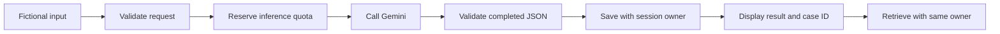
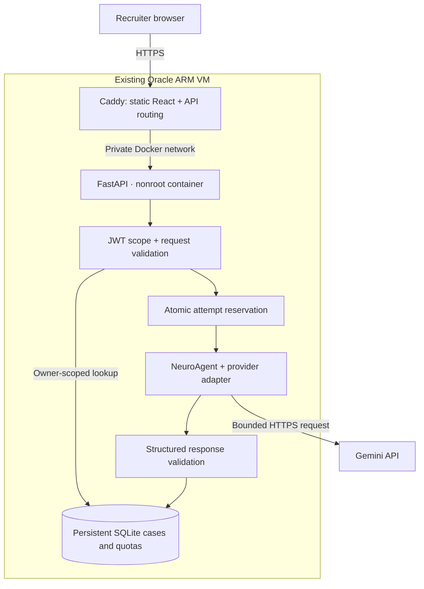
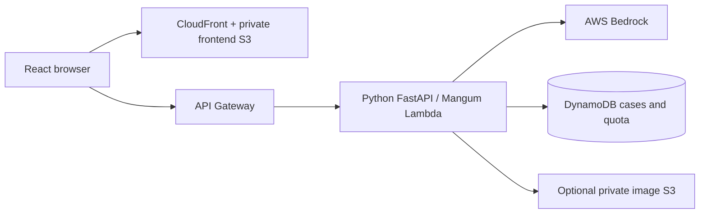

# NeuroAgent

### From a fictional case to a validated, saved AI response

A Python and React portfolio application that connects structured input, real model inference, response validation, and private case retrieval.

**[Open the live demo →](https://neuro-161-118-164-31.sslip.io/)** · [Cloud verification](docs/ORACLE_VERIFICATION.md) · [Engineering contributions](PORTFOLIO.md) · [Deployment guide](deploy/oracle/README.md)

[](https://github.com/dgexplores/neuro-agent/actions/workflows/ci.yml)
[](https://github.com/dgexplores/neuro-agent/actions/workflows/oracle-deploy.yml)

Maintained by [dgexplores](https://github.com/dgexplores), extending [thc1006/neuro-agent](https://github.com/thc1006/neuro-agent). Original authorship and source history are retained.

## Try it in one minute

1. Open **[NeuroAgent](https://neuro-161-118-164-31.sslip.io/)** and select **Start synthetic demo**. No account or API key is needed.
2. Select **Run fictional example**. The backend sends an invented headache example to Gemini and validates the returned JSON before saving it.
3. Copy the returned **case ID**. Open **Saved cases** and retrieve it during the same session.

| Live configuration | Details |
|---|---|
| Hosting | Existing Oracle Always Free ARM VM · Docker Compose · Caddy HTTPS |
| Model | Gemini 3.5 Flash-Lite; the configured Google project's billing was verified disabled |
| Session | 15 minutes, isolated from other demo sessions |
| Inference limit | One attempt per session and ten across the site per UTC day; failed attempts also count |
| Storage | SQLite on a persistent Docker volume |

The demonstration accepts a server-owned fictional example. Its public token cannot submit arbitrary assessments, images, or medication requests. Free-tier capacity and quotas can affect availability. **This is an educational software prototype, not a clinically validated diagnosis system.**

## The story: an AI answer is only one step

An invented case starts with a headache and light sensitivity. Displaying model text would make a quick demo, but would leave several engineering questions unanswered: Is the input valid? Did the model finish? Is the output structured correctly? Was the result actually saved? Can another visitor retrieve it?

This extension makes those steps explicit. FastAPI validates the request, a durable quota reserves the model attempt, the provider adapter requests JSON, and NeuroAgent checks the response structure and finite confidence values. Only a successfully stored response is returned. A later lookup checks the session owner in the database query.



Provider errors return service errors; malformed assessment JSON returns an error rather than a manufactured successful result. Model-reported confidence is not measured clinical accuracy.

## Architecture of the live demo



Caddy shares the existing host with [Vigil](https://github.com/dgexplores/vigil). The NeuroAgent backend binds only to localhost and the private edge network. It runs as UID 10001 with a read-only container root, a 512 MB memory cap, and a writable data volume. Secrets remain outside Git and frontend assets.

<details>
<summary>Preserved AWS architecture</summary>



The canonical [CDK project](infrastructure/cdk-clean/) retains the AWS architecture. Bedrock remains the default provider; Oracle explicitly selects Gemini. CDK synthesis, Linux Lambda-layer packaging and IAM assertions are tested. **This adaptation has not been deployed to AWS or verified against live Bedrock.** See [model configuration](docs/BEDROCK_MODELS.md) and [AWS release prerequisites](docs/DEPLOYMENT_READINESS.md).

</details>

## Engineering work in this extension

| Problem | Implemented behavior |
|---|---|
| A result disappears after the request | Persistent case repositories for SQLite and DynamoDB |
| A visitor guesses another case ID | Owner-scoped retrieval; absent and other-owner cases both return 404 |
| A provider fails or returns malformed text | Bounded provider calls, strict completion/JSON checks, explicit error responses |
| An unrestricted public model endpoint consumes quota | Opt-in fictional demo with scoped tokens and atomic session/day limits |
| Restarting resets the inference allowance | Quota reservations stored alongside cases in durable storage |
| Frontend routing breaks on refresh | Same-origin API routing, SPA fallback for browser routes, real 404s for missing assets |
| A deployment embeds credentials or loses data | Private runtime state, generated JWT secret, persistent volume, pinned SSH access |
| Cloud-specific code prevents another deployment | Explicit model-provider interface; AWS files retained alongside Oracle packaging |

The image adapter also supports real JPEG/PNG model requests with signature/size checks and validated findings. It is an operator capability, excluded from the public fictional demo. It does not implement DICOM processing or establish clinical image validity. See [provider contracts](docs/MODEL_PROVIDERS.md).

## Verified results

| Check | Recorded result |
|---|---|
| Backend regression suite | 181 tests passed locally, including the isolated offline Linux container |
| Frontend | 25 tests passed; production build passed |
| ARM packaging | Nonroot, read-only runtime; writable persistent SQLite volume; health and authentication checks passed |
| Live inference | Two fictional examples completed through actual Gemini: one API check and one browser check |
| Saved cases | Same-session retrieval passed; other-session access returned 404; missing authentication returned 401 |
| Public scope and quota | Unrestricted operation returned 403; a repeated attempt returned 429 |
| Restart recovery | Saved response and consumed quota survived backend restart |
| HTTPS and routing | Home, demo and saved-case deep links worked; missing assets returned 404 |

The initial live installation used the locally verified build. Hosted backend runner sign-off is tracked separately in [cloud verification](docs/ORACLE_VERIFICATION.md); a local pass is not presented as a completed hosted release. No medical accuracy, production availability, or load benchmark is claimed.

## Project structure

```text
neuro-agent/
├── backend/
│   ├── main.py                    # REST API, validation and persistence flow
│   ├── agents/neuro_agent.py      # Prompt, response checks and knowledge enrichment
│   ├── services/
│   │   ├── model_service.py       # Explicit provider selection
│   │   ├── gemini_service.py      # Bounded Gemini REST adapter
│   │   ├── bedrock_service.py     # Preserved AWS model adapter
│   │   ├── case_store.py          # SQLite / DynamoDB owner-scoped storage
│   │   └── demo_access.py         # Fictional examples and durable quotas
│   ├── utils/auth.py             # JWT validation and scoped demo tokens
│   └── tests/                    # Unit, HTTP and executable BDD contracts
├── frontend/src/                 # React routes, demo session, assessment and lookup
├── tests/                        # Provider, routing, storage and deployment contracts
├── deploy/oracle/                # ARM image, private config, release and checks
├── infrastructure/cdk-clean/     # Canonical preserved AWS infrastructure
├── .github/workflows/            # CI and gated cloud delivery
└── docs/                         # Evidence, architecture and operating guides
```

## Routes and API contracts

| Method / browser path | Purpose |
|---|---|
| `/`, `/demo`, `/history` | Overview, fictional example and saved-case lookup |
| `/diagnosis` | Operator assessment form; demo sessions are directed to fictional inputs |
| `/cases` | Redirect to saved-case lookup |
| `GET /health` | Liveness; explicitly does not test model connectivity |
| `GET /api/v1/demo/config` | Public fictional examples and limits |
| `POST /api/v1/demo/session` | Issue an isolated, short-lived demo token |
| `POST /api/v1/demo/diagnosis` | Reserve an attempt, infer, validate and persist the fictional result |
| `GET /api/v1/cases/{case_id}` | Retrieve a result for its authenticated owner |
| `POST /api/v1/diagnosis` | Operator-only freeform structured assessment |
| `POST /api/v1/upload-image` | Operator-only supported image analysis |
| `POST /api/v1/drug-interactions` | Operator-only local knowledge lookup |

Interactive API documentation is available at [`/docs`](https://neuro-161-118-164-31.sslip.io/docs). Viewing documentation does not grant an operator token.

## Run locally

Use Python 3.11, Make, and a supported Node release (22.22.2+).

```bash
git clone https://github.com/dgexplores/neuro-agent.git
cd neuro-agent
make install
cp .env.example .env
```

Set a new private `JWT_SECRET_KEY` in `.env`. Choose the provider explicitly: Bedrock uses your AWS credential chain; Gemini uses a backend-only `GEMINI_API_KEY`. Configure `MODEL_PROVIDER=gemini` and `DEMO_ACCESS_ENABLED=true` to enable the fictional demo locally. Model use requires actual access and quota; offline tests need neither.

```bash
make api  # Terminal 1: http://127.0.0.1:8000
make web  # Terminal 2: http://localhost:3000
make test
```

For a private operator session, generate a short-lived local token from the activated backend environment and enter it under **Advanced API access**:

```bash
python -c 'from dotenv import load_dotenv; load_dotenv(); from backend.utils.auth import create_access_token; print(create_access_token("local-demo", "local-demo"))'
```

Never put signing secrets or provider keys in the frontend. See [setup and deployment](docs/DEPLOYMENT_READINESS.md), [provider settings](docs/MODEL_PROVIDERS.md), and [CI/CD](docs/CI_CD.md).

## Delivery and boundaries

The manual Oracle workflow checks backend contracts, frontend tests/build/audit, dependency audit, preserved AWS synthesis, and native ARM packaging before rollout. It uploads a selected Git revision, retains private state and case storage, publishes immutable frontend assets, reloads Caddy and checks HTTPS/API routing. A deployment probe does not invoke the model. Rollback preserves data volumes; it is not a database migration rollback.

This project demonstrates Python OOP, REST APIs, SQL, authentication, debugging, automated testing, LLM integration, Git, containers, documentation and cloud delivery. It remains a single-host educational portfolio application. Production identity management, token revocation, retention/expiry of saved SQLite cases, clinical validation and high availability remain outside its scope. Sessions expire; stored fictional cases and SQLite quota records are not automatically purged.

## Attribution and licensing

Based on [thc1006/neuro-agent](https://github.com/thc1006/neuro-agent), originally created for the AWS AI Agent Global Hackathon 2025. Original awards, deployments, benchmarks and participation belong to their authors. This extension was developed with AI assistance; [PORTFOLIO.md](PORTFOLIO.md) distinguishes the added work.

Upstream licensing metadata is inconsistent: `pyproject.toml` says MIT, its original README described educational use, and the source has no root LICENSE. This adaptation does not assign a new license.
