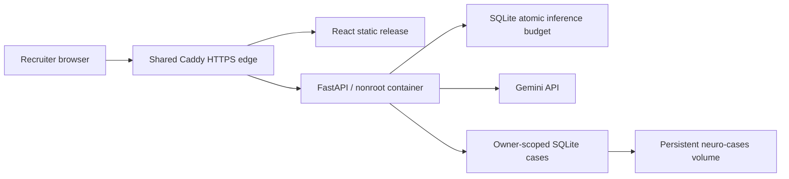

# Oracle synthetic demonstration

This optional deployment runs the Python API on an existing Oracle ARM host and
uses Gemini for the public fictional example. The default application provider
and canonical CDK architecture remain AWS Bedrock. This deployment does not
provision a VM, upgrade an account, create AWS resources, or guarantee free model
usage; use an account and model with an available free allowance.



The public session lasts 15 minutes and permits only the server-owned fictional
example. Every inference attempt reserves one durable quota unit before the
provider request: one attempt per session and ten across the site per UTC day.
Failed provider calls consume the reservation. General assessments, images, and
drug operations still require operator credentials. These are software
demonstrations and must not guide medical decisions.

## Host preparation

The existing shared edge must join the external Docker network `portfolio-edge`.
Its container name is `vigil-web-1`; it mounts `/opt/portfolio/www` at
`/srv/portfolio` read-only and `/opt/portfolio/caddy` at `/etc/caddy/sites`, and
imports `/etc/caddy/sites/*.caddy` from its main Caddyfile. Keep these settings in
Vigil's persistent deployment configuration so a later Vigil release retains them.

Create `/opt/neuro/releases`, `/opt/neuro/state`, `/opt/portfolio/www`, and
`/opt/portfolio/caddy`, writable by the deployment user `ubuntu`. Keep
`/opt/neuro/state` private with mode `0700`. The path `/opt/portfolio/www/neuro`
must initially be absent; releases manage it as a symlink. Docker Compose,
Python 3, `flock`, and noninteractive `sudo docker` are required.

For the initial release, prepare state using a private key file already saved on
the host, outside Git:

```bash
python3 deploy/oracle/prepare.py \
  --state-dir /opt/neuro/state \
  --hostname neuro-161-118-164-31.sslip.io \
  --revision YOUR_COMPLETE_40_CHARACTER_GIT_SHA \
  --gemini-key-file /private/path/to/gemini.key
```

The command generates a persistent JWT signing secret and private `agents.env`
and `compose.json` files. Later releases preserve the key and JWT secret; they
do not require the key file again. Never publish those state files or print
`docker compose config`; use `docker compose config --quiet` for validation.

The Oracle renderer explicitly sets `MODEL_PROVIDER=gemini`,
`GEMINI_MODEL=gemini-3.5-flash-lite`, `DEMO_ACCESS_ENABLED=true`,
`CASE_STORE_BACKEND=sqlite`, `CASE_DB_PATH=/data/cases.sqlite3`, and
`ALLOWED_ORIGINS=https://<hostname>`. The main application keeps public demo
access disabled unless explicitly configured. `--disable-demo` is available for
preparing an operator-only configuration.

## Releases and verification

The manual `oracle-deploy.yml` workflow runs the complete reusable CI suite and
builds the nonroot Oracle image on an ARM runner. The protected `oracle-demo`
environment needs these variables:

| Variable | Value |
| --- | --- |
| `ORACLE_DEPLOYMENT_ENABLED` | `true` after account and host setup |
| `ORACLE_HOST` | Existing host address |
| `ORACLE_DEMO_HOSTNAME` | Public NeuroAgent hostname |

Store the dedicated deployment key in `ORACLE_SSH_KEY` and the independently
verified SSH host entry in `ORACLE_KNOWN_HOSTS`. Provider keys and JWT signing
secrets remain on the host. Host verification is mandatory; the workflow never
uses `ssh-keyscan` or disables host checking.

Each release uses its full Git SHA for the source directory and backend image.
The frontend is rebuilt with the public HTTPS origin and uploaded alongside the
selected tracked source revision. Static releases live under
`/opt/portfolio/www/.neuro-releases/<SHA>`; one symlink switches the active site.
SQLite cases and quota reservations remain in the named `neuro-cases` volume.
The API binds only `127.0.0.1:8081` on the host and reaches Caddy through the
external network alias `neuro-api`.

The release script validates and reloads the existing Caddy edge and checks
backend health, public HTTPS, SPA routes, missing-asset `404`, and protected API
`401`. It issues no demo token or inference request. A separate, deliberate live
fictional assessment is needed to prove provider access and consumes quota.
If verification fails, available prior configuration and the frontend symlink
are restored; persistent volumes and source releases are retained for diagnosis.
Rollback assumes database schema compatibility with the previous application.
